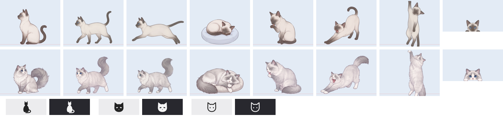

# Mochi 🐾

A desktop cat for macOS that wanders around your screen. Choose a Ragdoll or a Siamese.



## What it does
- Walks, runs, grooms, stretches, yawns, kneads, rolls over, tilts its head, loafs, and sleeps (when it gets sleepy it curls up in a corner of the screen)
- Parkour: leaps between windows like jumping across rooftops
- Hides behind windows and peeks out from the top, the sides, the bottom (upside down) and near the corners
- Chases your cursor, wiggles its bottom and pounces, or hangs from the cursor (shake the cursor and it swings)
- Pick it up and carry it, or throw it
- Several cats at once, each with its own breed
- Settings: activity level (calm / normal / playful), size, language (system / 한국어 / English), open at login

## Build and install
Requires Xcode or the Command Line Tools (`xcode-select --install`). Runs on macOS 12 or later.

```bash
./build.sh
```

The script builds the app, installs it straight into `/Applications/Mochi.app` and launches it. If an older Mochi is running, it is replaced with the new version.

## Controls
- Click: pet the cat
- Drag: pick it up and carry it (flick to throw)
- Right-click the cat, or click the menu bar icon: open the menu

## Project layout
- `Mochi.swift`: the whole app (AppKit, single file)
- `sprites/<breed>/*.png`: the artwork for each behavior
- `build.sh`: builds `Mochi.app` and installs it into Applications
