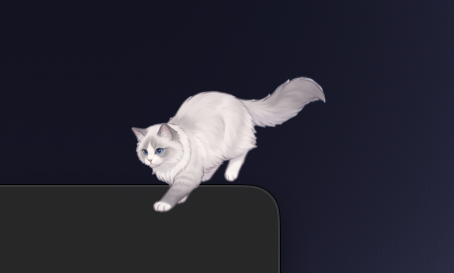
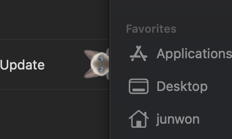

# Mochi 🐾

A desktop cat for macOS that wanders around your screen. Choose a Ragdoll or a Siamese.

<p>
  
  
</p>

## What it does
- Walks, runs, grooms, stretches, yawns, kneads, rolls over, tilts its head, loafs, and sleeps (when it gets sleepy it curls up in a corner of the screen)
- Parkour: leaps between windows like jumping across rooftops
- Hides behind windows and peeks out from the top, the sides, the bottom (upside down) and near the corners
- Chases your cursor, wiggles its bottom and pounces, or hangs from the cursor (shake the cursor and it swings)
- Builds invisible stepping stones in mid-air, but only to climb up to a high window or to your cursor
- Leave the cursor still for a while and it comes over, waits next to it, then dozes off there
- Watches videos with you: when a browser or video player is playing with a big window, it sits by the screen and looks up at it. With music only, it bobs its head. A sudden sound wakes a sleeping cat with a start
- Gets sleepier at night, and runs over to greet you when you wake or unlock your Mac
- Pick it up and carry it, or throw it
- Several cats at once, each with its own breed
- Settings: activity level (calm / normal / playful), size, language (system / 한국어 / English), open at login

## Build and install
Requires Xcode or the Command Line Tools (`xcode-select --install`). Runs on macOS 12 or later.

```bash
./build.sh
```

The script builds the app, installs it straight into `/Applications/Mochi.app` and launches it. If an older Mochi is running, it is replaced with the new version.

## Updates
Mochi checks GitHub for a new release once a day and asks before updating. You can also pick **Check for Updates…** from the menu. Updating downloads the new build, replaces the app and restarts it, so you don't need the project folder for this either.

Every push to `main` is built on macOS by a GitHub Action. To publish a new version, bump the number in `VERSION`; the build is then published as `Mochi.zip` in release `v<VERSION>`.

## Uninstall
You don't need the project folder to remove Mochi. Once it is installed, you can delete the folder.

- **From the app**: click the menu bar icon (or right-click the cat) and pick **Uninstall Mochi…**. It removes the login item and settings and moves the app to the Trash.
- **By hand**: quit Mochi, then drag `Mochi.app` from Applications to the Trash.
- If you still have the project folder, `./uninstall.sh` does the same as the menu item.

## Controls
- Click: pet the cat
- Drag: pick it up and carry it (flick to throw)
- Right-click the cat, or click the menu bar icon: open the menu

## Project layout
- `Mochi.swift`: the whole app (AppKit, single file)
- `sprites/<breed>/*.png`: the artwork for each behavior
- `build.sh`: builds `Mochi.app` and installs it into Applications
- `uninstall.sh`: removes the app, its settings and its login item
- `VERSION`: the app version; `.github/workflows/release.yml` builds every push and publishes new versions
